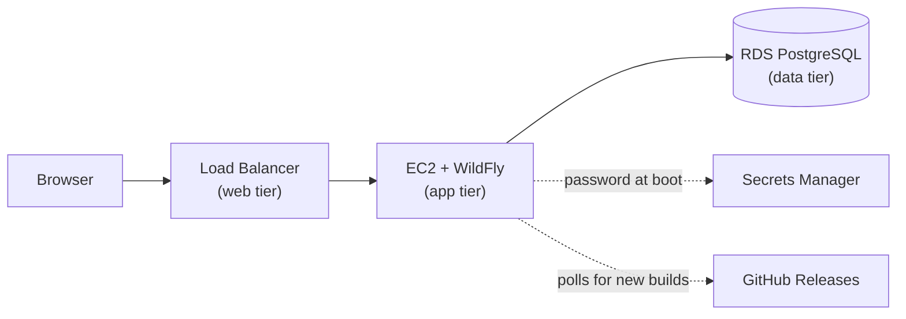

# IT Asset Inventory

> **A note on what's running:** this app was deployed and tested live on AWS. To keep costs down, the AWS resources are stopped when I'm not using them, so the live URL isn't always up. Account IDs, IP addresses, endpoints, and other identifying details have been left out of this repo, and screenshots are blurred before they go in.

I built this to learn how a production web app actually gets built, deployed, and updated in the cloud. It's an IT asset inventory where you log devices with their warranty and patch dates, and anything that hasn't been patched in 30 days gets flagged as overdue. The app is small on purpose. The real project is everything around it, including a 3-tier network on AWS, managed secrets, least-privilege access, and a CI/CD (Continuous Integration/Continuous Deployment) pipeline that deploys every change automatically and rolls back if something breaks.

This README covers **v1: the monolith on AWS**. The app is now being rebuilt as microservices on Kubernetes. This exact version is saved under the Git tag [`v1-monolith`](https://github.com/HakeemP210/asset-inventory/tree/v1-monolith).

## Architecture at a Glance

Each tier sits in its own security group and only accepts traffic from the tier in front of it. The database lives in private subnets with no route to the internet, and there's no SSH into the server at all.

## Why a Pull-Based Pipeline

The usual way for GitHub Actions to deploy to AWS is OIDC (OpenID Connect), where AWS is set up to trust GitHub directly. That feature wasn't available on my AWS plan, so I flipped the direction. GitHub builds the app, runs the tests, and publishes a release. The server checks for new releases on its own every 2 minutes, verifies the download, deploys it, and rolls back automatically if a smoke test fails.

This ended up being the stronger design for two reasons. First, GitHub holds zero AWS credentials, so a leaked token can't touch the cloud account. Second, it's the same model GitOps tools like Argo CD use on Kubernetes, which is where v2 is headed.

## Walkthrough

Each part of the build has its own write-up covering what was built, how, and why.

| # | Topic | Doc |
|---|---|---|
| 1 | Architecture, network, and tech stack | [`01-architecture.md`](docs/01-architecture.md) |
| 2 | Security design | [`02-security-design.md`](docs/02-security-design.md) |
| 3 | CI/CD pipeline and automatic rollback | [`03-cicd-pipeline.md`](docs/03-cicd-pipeline.md) |
| 4 | Troubleshooting log | [`04-troubleshooting.md`](docs/04-troubleshooting.md) |

## Known Limitations

These were left out of v1 on purpose:

- **HTTP only.** HTTPS needs a domain name for a certificate, so the load balancer only accepts my home IP for now.
- **No app login.** Same reason the load balancer is locked to my IP.
- **The app connects as the database master user** instead of a dedicated, lower-privilege user.
- **Password rotation needs a restart.** RDS rotates the secret every 7 days, and WildFly only reads it at startup.
- **Server setup was done by hand.** It isn't captured in Infrastructure as Code (Terraform) yet.

App hardening is being saved for the Kubernetes version so it only gets built once.

## What's Next

- [x] **v1:** Monolith on AWS with a pull-based CI/CD pipeline
- [ ] Containerize the monolith with Docker and Docker Compose
- [ ] Split it into Spring Boot microservices (assets, employees, front end), each with its own database
- [ ] Run it on a local Kubernetes cluster (kind)
- [ ] Move CI/CD to container images in GHCR (GitHub Container Registry) and deploy with Argo CD
- [ ] Add app hardening (HTTPS, login, secrets) inside Kubernetes

## Repo Contents

| Path | What it is |
|---|---|
| `README.md` | You're reading it |
| `docs/` | One write-up per part of the build |
| `src/main/java/` | REST API, database entity, and JAX-RS setup |
| `src/main/webapp/index.html` | The web page |
| `src/test/java/` | JUnit 5 and Mockito unit tests |
| `.github/workflows/ci-cd.yml` | Build, test, and release pipeline |
| `deploy/` | Server-side deploy script plus its systemd service and timer |
| `pom.xml`, `mvnw` | Maven build and wrapper |
