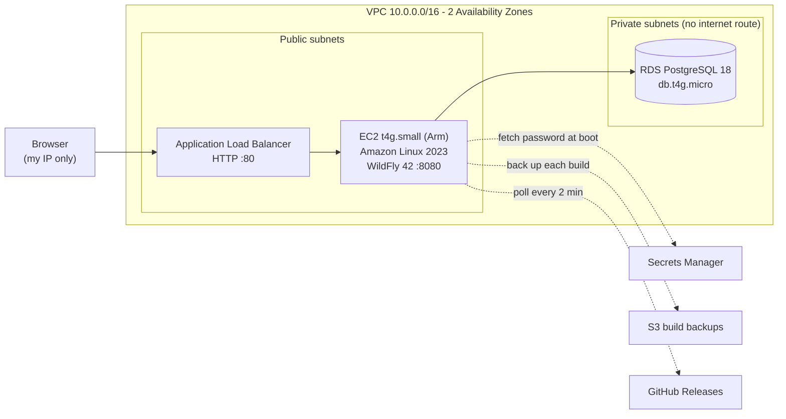

# 1. Architecture, Network, and Tech Stack

[← Back to README](../README.md)

## What Was Built

A classic 3-tier web application on AWS in the us-east-2 (Ohio) region, spread across 2 Availability Zones.

## The Three Tiers

| Tier | AWS service | Security group allows |
|---|---|---|
| Web | Application Load Balancer | Port 80 from my home IP only |
| App | EC2 running WildFly | Port 8080 from the load balancer only |
| Data | RDS PostgreSQL | Port 5432 from the app server only |

The security groups chain together, so each tier only accepts traffic from the one in front of it. Nothing on the internet can reach the app server or the database directly.

## Network Design

- **VPC:** one custom VPC (`10.0.0.0/16`) with 2 public and 2 private subnets across 2 Availability Zones.
- **Public subnets:** the load balancer and the app server.
- **Private subnets:** the database. They have no route to the internet, and the database isn't publicly accessible.
- **No NAT Gateway.** The database doesn't need outbound internet, and skipping the NAT Gateway saves roughly $30+ a month.
- **Load balancer health check:** `/asset-inventory/`, so a target is only marked healthy when the app itself responds.

## App Server

- **Instance:** EC2 `t4g.small` (Arm-based Graviton) running Amazon Linux 2023.
- **WildFly 42** installed under `/opt/wildfly` and run by a dedicated `wildfly` system user as a systemd service, so it starts automatically on boot.
- **Database connection:** a WildFly datasource (`InventoryDS`) using the PostgreSQL JDBC (Java Database Connectivity) driver over SSL.

## Tech Stack

| Layer | Technology |
|---|---|
| Language | Java 21 |
| Framework | Jakarta EE 11 (JAX-RS for the REST API, JPA/Hibernate for the database) |
| App server | WildFly 42 |
| Database | PostgreSQL (17 locally, 18 on RDS) |
| Build | Maven, via the Maven Wrapper |
| Tests | JUnit 5 and Mockito |
| Front end | Plain HTML and JavaScript |
| Cloud | VPC, EC2, RDS, Application Load Balancer, Secrets Manager, S3, IAM, Systems Manager |
| CI/CD | GitHub Actions, GitHub Releases, systemd timer |

## REST API

Base path: `/asset-inventory/api`

| Method | Endpoint | Action |
|---|---|---|
| GET | `/assets` | List all assets |
| POST | `/assets` | Add an asset |
| DELETE | `/assets/{id}` | Delete an asset |

## App Features

- Add, list, and delete IT assets (tag, type, model, serial number, warranty end, last patched date).
- Any device not patched in the last 30 days is highlighted in red as **overdue**.
