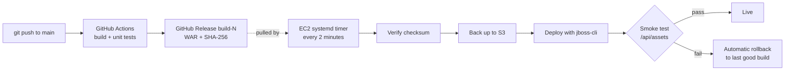

# 3. CI/CD Pipeline and Automatic Rollback

[← Back to README](../README.md)

## How It Works

## Stage 1: Build and Test (GitHub Actions)

Defined in [`.github/workflows/ci-cd.yml`](../.github/workflows/ci-cd.yml). It runs on every push and pull request to `main`.

1. Checks out the code and sets up Java 21.
2. Runs `./mvnw verify`, which compiles the app and runs the JUnit 5 and Mockito tests. A failing test stops the pipeline.
3. Saves the built WAR file.

## Stage 2: Publish a Release (GitHub Actions)

Only runs on pushes to `main`, never on pull requests.

1. Creates a SHA-256 checksum of the WAR.
2. Publishes a GitHub Release named `build-N` with the WAR and its checksum attached.

The workflow's default permissions are read-only. Only this job is allowed to write, and only to create the release.

## Stage 3: Deploy (on the Server)

A systemd timer runs [`deploy/deploy.sh`](../deploy/deploy.sh) every 2 minutes:

1. Asks GitHub for the latest release. If it's already deployed, or it's a build that failed before, it stops there.
2. Downloads the WAR and verifies its SHA-256 checksum.
3. Backs the build up to a versioned S3 bucket. Old builds expire after 30 days.
4. Deploys it with `jboss-cli`.
5. Smoke-tests `/api/assets` for an HTTP 200, retrying for up to 30 seconds.
6. **On success:** saves this build as the new "last good" build.
7. **On failure:** redeploys the last good build and records the failed release so it isn't retried.

## Why Pull Instead of Push

The common approach is for GitHub Actions to log in to AWS with OIDC (OpenID Connect) and push the deployment. That feature wasn't available on my AWS plan, so the server pulls instead. The benefits:

- **GitHub holds zero AWS credentials.** There's nothing in GitHub that can touch the cloud account.
- **The server only reaches out.** Nothing new has to be opened to the internet for deployments.
- **It's the GitOps model.** Tools like Argo CD and Flux work the same way on Kubernetes.

## Results

- Build 1 and build 2 both deployed automatically.
- A change pushed to `main` went live with no manual steps.
- The app came back on its own after a full server reboot.
